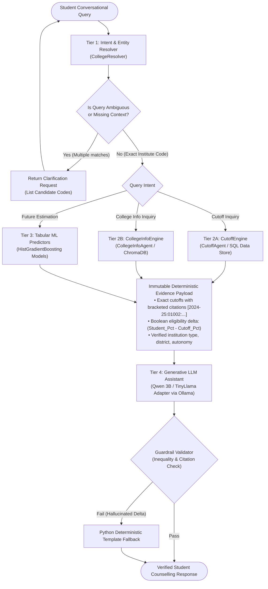

# AI-CON: Project Overview & System Architecture

**Document ID:** AI-CON-ARCH-01  
**Project Name:** AI-CON (AI Admissions Consultant for Maharashtra Engineering)  
**Target Domain:** Maharashtra State Common Entrance Test Cell (CET Cell) Centralized Admission Process (CAP)  
**Author:** Yash Hanamghar (`yashhanamghar9099`)  

---

## 1. Project Background & Problem Domain

The State Common Entrance Test Cell, Maharashtra conducts the Centralized Admission Process (CAP) annually for admission into 4-year undergraduate engineering and technology degree courses (B.E. / B.Tech). The ecosystem is one of the largest and most complex higher-education admission systems in India:

- **1,041 participating engineering institutions** across 36 districts of Maharashtra.
- **Over 150,000 engineering seats** allocated across multiple distinct quotas and categories.
- **Multi-Round Dynamic Allocation (Rounds 1, 2, and 3)**: Seat cutoffs change significantly from round to round as seats are absorbed or vacated.
- **Complex Quota Bifurcation**:
  - *Home University (HU)*: 70% of non-autonomous college seats reserved for candidates from the affiliating university district.
  - *Other than Home University (OHU)*: 30% of seats open to Maharashtra candidates from outside the home university area.
  - *State Level (SL)*: Applicable to government, autonomous, and minority institutions.
  - *All India (AI)*: Quota filled via JEE Main scores (or MHT-CET merit).
- **Statutory & Horizontal Reservations**:
  - Open, SC (13%), ST (7%), VJ/DT (3%), NT-A, NT-B (2.5%), NT-C (3.5%), NT-D (2%), OBC (19%), SBC, SEBC (10%), EWS (10%).
  - Horizontal reservations: PWD (5%), DEF (Defense 5%), Female (30% in HU/OHU/SL).
  - TFWS (Tuition Fee Waiver Scheme: 5% supernumerary seats).

### The Student Problem
Every year, thousands of students make catastrophic errors on their CAP preference forms (Option Forms):
1. **Misinterpreting Cutoffs**: Confusing percentiles with marks or comparing across different categories (e.g. assuming an Open category cutoff applies to OBC).
2. **Preference Form Waste**: The official CET form allows up to **300 choice codes**. Students frequently list only 5 to 15 colleges, wasting their safety tiers.
3. **Geographical & Feasibility Traps**: Selecting distant colleges without checking location or daily transit feasibility.
4. **LLM Hallucinations**: Standard chatbots (ChatGPT, generic LLMs) invent colleges, hallucinate cutoff percentiles, or make false guarantees like *"With 85 percentile, you are guaranteed COEP Computer Science."*

---

## 2. AI-CON Solution Philosophy

AI-CON solves this problem through a **Hybrid Deterministic-Generative Pipeline**:
- **Zero Generative Math**: An LLM is never allowed to predict or look up numerical cutoffs or calculate inequalities.
- **Deterministic Grounding**: Historical cutoff data (181,137 records) is queried via exact SQL/Parquet lookups.
- **Validated College Intelligence**: Institutional details (autonomy, affiliations, NBA accreditations, districts) are grounded via ChromaDB vector embeddings over verified JSON profiles.
- **Tabular Machine Learning**: Gradient-boosted regressors estimate expected closing ranks and percentiles with measurable error bounds ($R^2 \approx 0.58$).
- **Constrained Verbalization**: The LLM's role is strictly confined to reading the deterministic evidence payload, explaining trade-offs, and asking clarifying questions when evidence is ambiguous.

---

## 3. The 4-Tier Hybrid Architecture

The diagram below illustrates the end-to-end dataflow when a student asks a counselling question:



---

## 4. Component Responsibilities & Invariants

### Tier 1: Intent & Entity Resolver (`scripts/agents/college_resolver.py`)
- **Knowledge Base**: 1,041 verified higher education institutions from `cutoffs/college_ai_consultant_sparse_enriched_v4_no_cutoffs/college_dataset_index.csv`.
- **Matching Engine**: Normalized alias mapping, token overlap, and Levenshtein distance fuzzy matching.
- **Ambiguity Policy**: If a user says *"Government College"* (which matches 15+ institutes in Amravati, Yavatmal, Aurangabad, Karad, Pune, etc.), the resolver **must halt** and return `NEEDS_CLARIFICATION` with candidate codes.

### Tier 2A: Cutoff Engine (`scripts/agents/cutoff_agent.py`)
- **Data Source**: 181,137 historical seat allotment records across academic years 2020-21 through 2024-25.
- **Lookup Dimensions**: `institute_code`, `academic_year`, `course_code`, `cap_round`, `seat_type`, `candidature_type`.
- **Output**: Structured list of cutoffs with explicit citation tags: `[academic_year:institute_code:course_code:quota:round:stage]`.

### Tier 2B: College Info Engine (`scripts/agents/college_info_agent.py`)
- **Data Source**: ChromaDB vector collection (`vector_index/chroma.sqlite3`) over 1,041 institution profile JSON files.
- **Attributes Retrieved**: University affiliation (e.g. SPPU, Mumbai University, DBATU), autonomy status (Government Autonomous, Unaided, Autonomous), district, verified website, and courses offered.

### Tier 3: Tabular Machine Learning Models (`model_artifacts/*.joblib`)
- **Model Type**: Scikit-learn `HistGradientBoostingRegressor`.
- **Purpose**: When historical data is incomplete or students request estimations for upcoming admission cycles, the tabular model predicts closing rank ($R^2 = 0.5808$, MAE = 28,259) and closing percentile ($R^2 = 0.5366$, MAE = 14.88%) based on historical seat matrix features.

### Tier 4: Generative LLM Assistant (`scripts/ollama_client.py`)
- **Serving Engine**: Ollama running locally at `http://localhost:11434`.
- **Evaluated Checkpoints**:
  - `qwen2.5-aicon:latest` (Qwen2 3B Instruct, Q5_K_M GGUF).
  - `qwen2.5:7b` (Qwen2 7B Instruct, Q4_K_M GGUF reference model).
  - `model_artifacts/lora_adapter` (TinyLlama 1.1B PEFT adapter).
- **System Instructions**:
  ```text
  You are an admission decision-support assistant for Maharashtra engineering colleges. 
  Use only the supplied evidence. Cite evidence IDs in [brackets]. 
  Never promise admission. If evidence is missing, answer with status=insufficient_evidence.
  ```

---

## 5. Architectural Safeguards Against Real-World Harm

| Failure Mode | Naive LLM Behavior | AI-CON Architectural Safeguard |
|:---|:---|:---|
| **Mathematical Inversion** | Autoregressively asserts `92.40 > 95` makes student eligible. | Python floating-point comparator `student_pct >= cutoff_pct` evaluates eligibility before LLM generation. |
| **Geographical Hallucination** | Recommends a Nagpur college (700 km away) for a Pune commute. | District coordinates and commute radiuses are checked in metadata before recommending colleges. |
| **Authority Hallucination** | Invents non-existent authorities like "MSET" or "Maharashtra University". | Prompt strictly limits citations to bracketed IDs from the official CET Cell brochure. |
| **Option Form Misinformation** | Claims preference list is capped at 5 or 15 choices. | System explicitly informs students of CET Rule 9(1) permitting up to **300 preference choices**. |
| **Document Verification Traps** | Assumes candidate has category reservations without proof. | System enforces statutory verification of Caste Validity Certificate and Non-Creamy Layer (NCL). |
