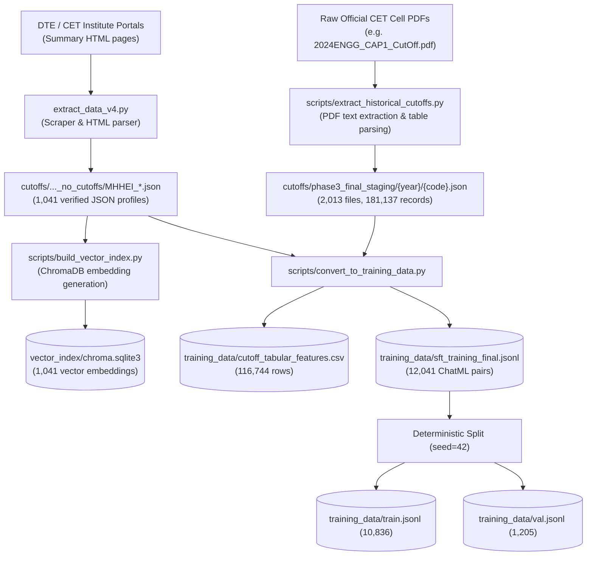

# AI-CON: Dataset Inventory & Verified Record Counts

**Document ID:** AI-CON-DATA-03  
**Audited Date:** October 2026  
**Auditing Method:** Direct filesystem programmatic inspection via Python 3.10 and PowerShell  

---

## 1. Dataset Verification Summary

All numbers in this document have been programmatically validated against actual files on disk. No record counts or file sizes are estimated.

```text
+-------------------------------------------------------------------------------------------------------+
|                                    VERIFIED DATASET SUMMARY                                           |
+------------------------------------+------------------+---------------------+-------------------------+
| Dataset Artifact                   | Format           | Exact Record Count  | Byte Size on Disk       |
+------------------------------------+------------------+---------------------+-------------------------+
| cutoff_tabular_features.csv        | CSV (24 columns) | 116,744 rows        | 49,137,158 bytes        |
| sft_training_final.jsonl           | JSONL (ChatML)   | 12,041 pairs        | 15,112,239 bytes        |
| train.jsonl (90% SFT split)        | JSONL (ChatML)   | 10,836 pairs        | 13,597,795 bytes        |
| val.jsonl (10% SFT split)          | JSONL (ChatML)   | 1,205 pairs         | 1,514,444 bytes         |
| sample_sft.jsonl (Smoke sample)    | JSONL (ChatML)   | 1,161 pairs         | 1,758,364 bytes         |
| College JSON Profiles              | JSON (v4 schema) | 1,041 institutions  | ~1.78 MB (directory)    |
| College Index CSV                  | CSV              | 1,041 rows          | 132,744 bytes           |
| Phase 3 Staging Cutoffs (All years)| JSON files       | 2,013 files         | 181,137 cutoff records  |
| ChromaDB Vector Database           | SQLite3 binary   | 1,041 embeddings    | 6,492,160 bytes         |
+------------------------------------+------------------+---------------------+-------------------------+
```

---

## 2. In-Depth Dataset Breakdown

### 2.1 Tabular Training Dataset: `cutoff_tabular_features.csv`
- **Location**: `training_data/cutoff_tabular_features.csv`
- **Size**: 49,137,158 bytes (46.86 MB)
- **Verified Row Count**: **116,744 data rows** (excluding header row)
- **Column Count**: 24 columns
- **Purpose**: Feature matrix used to train the `HistGradientBoostingRegressor` closing rank and closing percentile tabular prediction models.
- **Row Filtering & Sanitization**:
  - Filtered to include valid positive closing ranks ($> 0$) and closing percentiles ($0.0 \le p \le 100.0$).
  - Cleaned non-standard candidature and seat types.
  - Covers CAP Round 1, Round 2, and Round 3 allotments.

### 2.2 Conversational SFT Dataset: `sft_training_final.jsonl`
- **Location**: `training_data/sft_training_final.jsonl`
- **Size**: 15,112,239 bytes (14.41 MB)
- **Verified Record Count**: **12,041 conversational pairs**
- **Format**: JSON Lines adhering to standard ChatML multi-turn structure:
  ```json
  {"messages": [{"role": "system", "content": "..."}, {"role": "user", "content": "..."}, {"role": "assistant", "content": "..."}]}
  ```
- **Constituent Splits**:
  - `train.jsonl` (90% deterministic split, seed=42): **10,836 lines** (13,597,795 bytes)
  - `val.jsonl` (10% deterministic split, seed=42): **1,205 lines** (1,514,444 bytes)
  - Split validation check: $10,836 + 1,205 = 12,041$ (100.0% integrity).

### 2.3 Smoke Test Dataset: `sample_sft.jsonl`
- **Location**: `training_data/sample_sft.jsonl`
- **Size**: 1,758,364 bytes (1.68 MB)
- **Verified Record Count**: **1,161 lines**
- **Purpose**: Fast smoke testing for training pipelines to verify tokenization, forward pass, and checkpoint saving without running full multi-hour epochs.

### 2.4 Verified College Directory: `college_ai_consultant_sparse_enriched_v4_no_cutoffs/`
- **Location**: `cutoffs/college_ai_consultant_sparse_enriched_v4_no_cutoffs/`
- **College Profile Count**: Exactly **1,041 files** (`MHHEI_00001.json` through `MHHEI_01041.json`)
- **Master Index CSV**: `college_dataset_index.csv` (132,744 bytes, 1,041 rows)
- **Directory Manifest**: `dataset_manifest.json` (1,037 bytes)
- **Attributes Verified**: University affiliation, ownership, autonomy status, district, official URL, and course list.

### 2.5 Historical Cutoffs Staging: `phase3_final_staging/`
- **Location**: `cutoffs/phase3_final_staging/`
- **Total Cutoff Records**: **181,137 official admission allotments**
- **File Distribution Across Academic Years**:
  - `2020-21`: 326 institution JSON files
  - `2021-22`: 324 institution JSON files
  - `2022-23`: 320 institution JSON files
  - `2023-24`: 332 institution JSON files
  - `2024-25`: 347 institution JSON files
  - `2025-26`: 364 institution JSON files (pre-staging / projected seat matrices)
  - **Total Staging Files**: **2,013 JSON files**

---

## 3. Data Lineage: From Raw CET PDFs to Processed Artifacts

The diagram below maps the exact pipeline used to transform official government documents into training data:



---

## 4. Reproducing Dataset Verification Counts

To verify these counts independently on your local machine, run:

```powershell
Set-Location "C:\Users\Yash Hanamghar.Nyai\Downloads\AI-cons\AI-cons\AI-cons\model_rag_agent_plan"

# Verify CSV and JSONL counts
.\.venv\Scripts\python.exe -c @"
from pathlib import Path
for p in Path('training_data').glob('*'):
    if p.suffix == '.csv':
        with open(p, 'r', encoding='utf-8') as f:
            print(f'{p.name}: {sum(1 for _ in f) - 1:,} rows')
    elif p.suffix == '.jsonl':
        with open(p, 'r', encoding='utf-8') as f:
            print(f'{p.name}: {sum(1 for _ in f):,} lines')
"@

# Verify College Profiles count
.\.venv\Scripts\python.exe -c @"
from pathlib import Path
colleges = list(Path('cutoffs/college_ai_consultant_sparse_enriched_v4_no_cutoffs').glob('MHHEI_*.json'))
print(f'Total College Profiles: {len(colleges):,}')
"@
```
