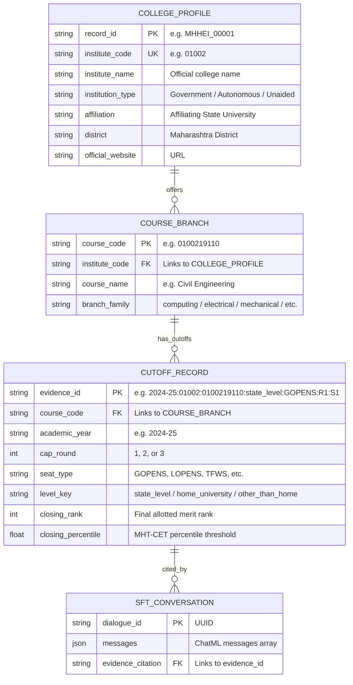

# AI-CON: Data Models, Schemas & Entity Relationships

**Document ID:** AI-CON-SCHEMA-04  
**Schema Version:** 4.0.0 (Maharashtra CAP Engineering Standard)  
**Primary Identifiers:** `institute_code`, `course_code`, `evidence_id`, `record_id`  

---

## 1. Entity-Relationship Overview

The AI-CON data model connects four core entities:
1. **Institution (`CollegeProfile`)**: Physical college campus, affiliations, autonomy status, and location.
2. **Course (`Branch`)**: 4-year degree programs offered at a specific institution (e.g. Computer Engineering, Artificial Intelligence).
3. **Cutoff Record (`CutoffRecord`)**: Historical closing merit rank and percentile for a specific seat type, round, and year.
4. **Conversational SFT Pair (`CounsellingDialogue`)**: Grounded multi-turn dialogue linking evidence to responses.



---

## 2. Tabular Feature Schema: `cutoff_tabular_features.csv`

The tabular dataset contains 24 features used for predictive modelling of closing ranks and percentiles:

| Column Name | Data Type | Nullable | Example Value | Description |
|:---|:---:|:---:|:---|:---|
| `academic_year` | String | No | `"2024-25"` | Academic admission year (e.g. `2020-21` to `2024-25`). |
| `all_india_merit_no` | Float | Yes | `98.0` | All India merit rank (for AI / JEE Main quota). |
| `branch_family` | String | No | `"computing"` | Canonical branch family (`computing`, `circuital`, `mechanical`, `civil`, `chemical`, `emerging_tech`). |
| `candidature_type` | String | No | `"AI to AI"`, `"Maharashtra"` | Domicile / eligibility stream. |
| `cap_round` | Integer | No | `1` | CAP allotment round (`1`, `2`, or `3`). |
| `closing_percentile` | Float | No | `99.7006242` | **Target Variable**: Final closing MHT-CET percentile ($0.0 \le p \le 100.0$). |
| `closing_rank` | Integer | No | `98` | **Target Variable**: Final state general merit rank ($1 \le r \le 200,000$). |
| `course_code` | String | No | `"600624510"` | 9-digit official DTE course choice code. |
| `course_name` | String | No | `"Computer Engineering"` | Standardized engineering branch title. |
| `course_name_note` | String | Yes | `""` | Shift or language remarks (e.g. Second Shift). |
| `evidence_id` | String | No | `"2024-25:01002:..."` | Immutable global citation identifier. |
| `exam` | String | No | `"MHT-CET"`, `"JEE Main"` | Qualifying examination basis. |
| `home_university` | String | No | `"Amravati University"` | Affiliating university governing home-quota boundaries. |
| `institute_code` | String | No | `"01002"` | 4-5 digit official DTE institute code. |
| `institute_name` | String | No | `"Government College..."`| Full statutory name of the college. |
| `level_key` | String | No | `"state_level"` | Quota tier: `state_level`, `home_university`, `other_than_home_university`. |
| `level_label` | String | No | `"State Level"` | Human-readable quota tier label. |
| `list_type` | String | No | `"maharashtra_minority"`| Seat allocation stream type. |
| `name_confidence` | Float | No | `1.0` | Confidence score for college entity matching. |
| `page` | Integer | No | `1` | Source PDF page number from CET Cell bulletin. |
| `seat_type` | String | No | `"GOPENS"`, `"TFWS"` | Exact reservation category code. |
| `source_file` | String | No | `"2024ENGG_CAP1_CutOff.pdf"` | Source official PDF publication. |
| `stage` | String | No | `"1"` | Seat allocation stage (`1` or `2`). |
| `status` | String | No | `"active"` | Record status. |

---

## 3. Conversational SFT Dialogue Schema: `sft_training_final.jsonl`

Every line in `sft_training_final.jsonl` adheres to the 3-role ChatML format:

```json
{
  "messages": [
    {
      "role": "system",
      "content": "You are an admission decision-support assistant for Maharashtra engineering colleges. Use only the supplied evidence. Cite evidence IDs in [brackets]. Never promise admission. If evidence is missing, answer with status=insufficient_evidence."
    },
    {
      "role": "user",
      "content": "EVIDENCE:\n[2024-25:01002:0100219110:state_level:GOPENS:R1:S1] 2024-25 Government College of Engineering, Amravati - Civil Engineering - GOPENS (General (male), Open, State Level): round 1 stage 1, closing rank 34240, percentile 88.5013511, list type maharashtra_minority (source: 2024ENGG_CAP1_CutOff.pdf, page 1)\n\nUSER QUERY:\nWhat was the GOPENS cutoff for Civil Engineering at Government College of Engineering, Amravati in 2024-25 Round 1?"
    },
    {
      "role": "assistant",
      "content": "According to the official Maharashtra CAP Round 1 cutoff records [2024-25:01002:0100219110:state_level:GOPENS:R1:S1], the GOPENS (General Open, State Level) closing merit rank for Civil Engineering at Government College of Engineering, Amravati in 2024-25 was 34,240, corresponding to an MHT-CET percentile of 88.5013511. Note that cutoffs fluctuate annually based on candidate demand and seat matrix updates."
    }
  ]
}
```

---

## 4. College Profile Schema: `MHHEI_*.json`

Located in `cutoffs/college_ai_consultant_sparse_enriched_v4_no_cutoffs/`:

```json
{
  "schema_version": "v4",
  "record_id": "MHHEI_00001",
  "institute_code": "01002",
  "institute_name": "Government College of Engineering, Amravati",
  "official_website": "https://www.gcoea.ac.in/",
  "institution_type": "Government Autonomous",
  "extracted": {
    "affiliation": "Sant Gadge Baba Amravati University",
    "ownership": "Government Autonomous",
    "district": "Amravati",
    "state": "Maharashtra",
    "courses_offered": [
      "Civil Engineering",
      "Computer Science and Engineering",
      "Electrical Engineering",
      "Electronics and Telecommunication Engineering",
      "Mechanical Engineering",
      "Information Technology"
    ]
  },
  "sources_consulted": [
    "https://www.gcoea.ac.in/",
    "https://fe2026.mahacet.org/StaticPages/frmInstituteSummary?InstituteCode=01002"
  ],
  "last_processed_at": "2026-10-14T00:21:00Z"
}
```

---

## 5. Cutoff Evidence Identifier Specification

The `evidence_id` format guarantees deterministic traceability back to the exact page of the government PDF:

$$\text{evidence\_id} = \langle\text{AcademicYear}\rangle:\langle\text{InstituteCode}\rangle:\langle\text{CourseCode}\rangle:\langle\text{LevelKey}\rangle:\langle\text{SeatType}\rangle:\text{R}\langle\text{Round}\rangle:\text{S}\langle\text{Stage}\rangle$$

**Example:** `2024-25:01002:0100219110:state_level:GOPENS:R1:S1`
- `2024-25`: Admission year.
- `01002`: Government College of Engineering, Amravati.
- `0100219110`: Civil Engineering course code.
- `state_level`: State Level seat allocation.
- `GOPENS`: General Open State seat.
- `R1`: CAP Round 1.
- `S1`: Stage 1 allotment.
