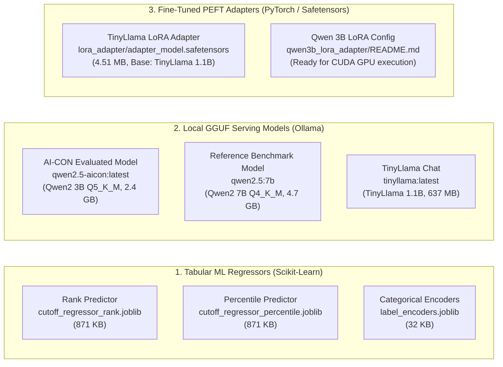

# AI-CON: Model Inventory, Base Models, Adapters & Configurations

**Document ID:** AI-CON-MODEL-05  
**Audited Date:** October 2026  
**Artifact Storage Root:** `C:\Users\Yash Hanamghar.Nyai\Downloads\AI-cons\AI-cons\AI-cons\model_rag_agent_plan\model_artifacts`  

---

## 1. Architectural Distinction & Model Taxonomy

To avoid common confusion during onboarding, note the strict functional separation among model families:



---

## 2. Tabular Prediction Models (`model_artifacts/*.joblib`)

The tabular regressors estimate historical closing ranks and closing percentiles when querying courses or hypothetical trends.

### Model Specifications
- **Algorithm**: `sklearn.ensemble.HistGradientBoostingRegressor`
- **Trained Artifacts**:
  - `model_artifacts/cutoff_regressor_rank.joblib` (871,976 bytes)
  - `model_artifacts/cutoff_regressor_percentile.joblib` (871,976 bytes)
  - `model_artifacts/label_encoders.joblib` (32,750 bytes)
- **Hyperparameters**:
  ```python
  HistGradientBoostingRegressor(
      loss='squared_error',
      learning_rate=0.1,
      max_iter=100,
      max_leaf_nodes=31,
      min_samples_leaf=20,
      l2_regularization=0.0,
      random_state=42
  )
  ```
- **Feature Set (7 features)**:
  1. `institute_code` (Label Encoded)
  2. `course_code` (Label Encoded)
  3. `seat_type` (Label Encoded)
  4. `candidature_type` (Label Encoded)
  5. `academic_year` (Label Encoded)
  6. `cap_round` (Integer: 1, 2, or 3)
  7. `stage` (Label Encoded)

### Verified Evaluation Metrics (`model_artifacts/tabular_metrics.json`)
- **Total Training Set**: 116,744 samples (Train: 99,232, Held-out Test: 17,512)
- **Training Duration**: 2.68 seconds
- **Rank Model Performance**:
  - **$R^2$ Score**: **0.5713** (Evaluated test set: **0.5808**)
  - **Mean Absolute Error (MAE)**: **28,348.76** (Test set: **28,259.22**)
  - **Root Mean Squared Error (RMSE)**: 35,719.52
- **Percentile Model Performance**:
  - **$R^2$ Score**: **0.5261** (Evaluated test set: **0.5366**)
  - **Mean Absolute Error (MAE)**: **15.04%** (Test set: **14.88%**)
  - **Root Mean Squared Error (RMSE)**: 19.22%

---

## 3. Local Language Models (`Ollama Engine`)

Local conversational inference runs via Ollama on `localhost:11434`.

### 3.1 Evaluated Production Model: `qwen2.5-aicon:latest`
- **Base Architecture**: `Qwen/Qwen2.5-Coder-3B-Instruct` / `Qwen2.5-3B-Instruct`
- **Quantization**: `Q5_K_M` (5-bit K-quantization medium)
- **Serving Format**: GGUF
- **File Size**: 2.4 GB
- **Layers & Dimensions**: 36 Transformer layers, hidden dimension 2048, 16 attention heads.
- **Modelfile Configuration**:
  ```dockerfile
  FROM sha256-eb863f2a1a9b67e33bbf2dad98ea09c03b71c8052aeb4835171cf6f7a7a12db4
  TEMPLATE "{{ .Prompt }}"
  SYSTEM "You are an admission decision-support assistant for Maharashtra engineering colleges. Use only the supplied evidence. Cite evidence IDs in [brackets]. Never promise admission. If evidence is missing, answer with status=insufficient_evidence."
  PARAMETER stop "<|im_end|>"
  PARAMETER stop "<|im_start|>"
  PARAMETER temperature 0
  PARAMETER top_p 0.95
  ```
- **Average Response Latency**: **20.44 seconds** (multithreaded CPU inference).

### 3.2 Reference Benchmark Model: `qwen2.5:7b`
- **Base Architecture**: `Qwen/Qwen2.5-7B-Instruct`
- **Quantization**: `Q4_K_M` (4-bit K-quantization medium)
- **Serving Format**: GGUF
- **File Size**: 4.7 GB
- **Layers & Dimensions**: 28 Transformer layers, hidden dimension 3584.
- **Average Response Latency**: **37.92 seconds** (multithreaded CPU inference).

---

## 4. Fine-Tuned PEFT LoRA Adapters (`model_artifacts/lora_adapter/`)

### 4.1 TinyLlama LoRA Adapter (Trained & Published Ready)
- **Base Model**: `TinyLlama/TinyLlama-1.1B-Chat-v1.0`
- **Framework**: PyTorch 2.1 + Hugging Face PEFT 0.21.2
- **Adapter Files**:
  - `adapter_model.safetensors` (4,517,152 bytes / ~4.31 MB)
  - `adapter_config.json` (1,157 bytes)
  - `chat_template.jinja` (424 bytes)
  - `tokenizer.json` (3,619,134 bytes)
  - `tokenizer_config.json` (413 bytes)
  - `training_metrics.json` (297 bytes)
- **LoRA Hyperparameters**:
  ```json
  {
    "peft_type": "LORA",
    "task_type": "CAUSAL_LM",
    "r": 8,
    "lora_alpha": 16,
    "lora_dropout": 0.05,
    "target_modules": ["q_proj", "v_proj"],
    "bias": "none"
  }
  ```
- **Training Metrics**:
  - Duration: 239.19 seconds (10 global steps, batch size 4)
  - Final Training Loss: **4.0013**
  - Checkpoints: `checkpoint-5`, `checkpoint-10`

### 4.2 Qwen 3B QLoRA Adapter (`model_artifacts/qwen3b_lora_adapter/`)
- **Base Model**: `Qwen/Qwen2.5-Coder-3B-Instruct` (or `Qwen/Qwen2.5-3B-Instruct`)
- **Status**: The script `scripts/train_qwen_lora.py` has been updated with pre-trained weight loading (`from_pretrained`) and full architecture layer retention.
- **Current Blocker**: Full 4-bit QLoRA requires `bitsandbytes` with a CUDA-enabled PyTorch environment (`torch 2.1+cu121`). The current virtual environment is CPU-only (`2.14.1+cpu`). Training is ready to run as soon as CUDA PyTorch is installed.
