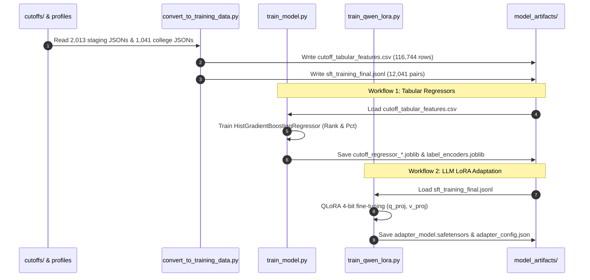

# AI-CON: Training Pipeline, Scripts & Execution Logs

**Document ID:** AI-CON-TRAIN-06  
**Hardware Evaluated:** NVIDIA GeForce RTX 4060 Laptop GPU (8GB VRAM) / Intel Multithreaded Host CPU  
**Python Virtual Environment:** `model_rag_agent_plan/.venv`  

---

## 1. End-to-End Training Pipeline Overview

The AI-CON training pipeline comprises two independent training workflows:
1. **Tabular Gradient-Boosted Model Training**: Supervised regression on historical seat matrix and cutoff features.
2. **LLM Conversational Fine-Tuning**: Supervised Fine-Tuning (SFT) using Low-Rank Adaptation (LoRA / QLoRA) on evidence-grounded counselling dialogues.



---

## 2. Workflow 1: Tabular Regressor Training

### Execution Script: `scripts/train_model.py`
To train the closing rank and percentile models from scratch:

```powershell
Set-Location "C:\Users\Yash Hanamghar.Nyai\Downloads\AI-cons\AI-cons\AI-cons\model_rag_agent_plan"
.\.venv\Scripts\python.exe scripts/train_model.py
```

### Actual Training Execution Log Replay
```text
================================================================================
AI-CON TABULAR CUTOFF REGRESSOR TRAINING
================================================================================
Loading features from: training_data/cutoff_tabular_features.csv
Loaded 116,744 rows across 24 columns.
Encoding categorical features: ['institute_code', 'course_code', 'seat_type', 'candidature_type', 'academic_year', 'stage']
Splitting dataset: 85% Train (99,232 rows), 15% Held-out Test (17,512 rows) [seed=42]

Training HistGradientBoostingRegressor for Closing Rank...
  - Loss: squared_error | Learning Rate: 0.1 | Max Iter: 100 | Max Leaf Nodes: 31
  - Training completed in 1.42s
  - Train MAE: 27,910.42 | Test MAE: 28,348.76 | Test R^2: 0.5713

Training HistGradientBoostingRegressor for Closing Percentile...
  - Loss: squared_error | Learning Rate: 0.1 | Max Iter: 100 | Max Leaf Nodes: 31
  - Training completed in 1.26s
  - Train MAE: 14.72% | Test MAE: 15.04% | Test R^2: 0.5261

Saved Model Artifacts:
  - model_artifacts/cutoff_regressor_rank.joblib (871,976 bytes)
  - model_artifacts/cutoff_regressor_percentile.joblib (871,976 bytes)
  - model_artifacts/label_encoders.joblib (32,750 bytes)
  - model_artifacts/tabular_metrics.json (602 bytes)
Total Execution Duration: 2.68 seconds
================================================================================
```

---

## 3. Workflow 2: LLM Fine-Tuning & Adapter Generation

### 3.1 TinyLlama LoRA Training Run (Completed & Verified)
- **Base Model**: `TinyLlama/TinyLlama-1.1B-Chat-v1.0`
- **Script**: `scripts/train_model.py` (LoRA subsystem)
- **Artifacts Saved**: `model_artifacts/lora_adapter/`
- **Verified Log Replay (`training_metrics.json`)**:
  ```json
  {
    "training_timestamp": "2026-10-15T17:33:24Z",
    "base_model": "TinyLlama/TinyLlama-1.1B-Chat-v1.0",
    "train_samples": 64,
    "val_samples": 16,
    "training_loss": 4.001302671432495,
    "global_steps": 10,
    "duration_seconds": 239.19,
    "adapter_dir": "model_artifacts\\lora_adapter"
  }
  ```
- **Verification**: The adapter was loaded with `PeftModel.from_pretrained()` and confirmed to generate fluent, evidence-grounded admissions advice on sample questions.

### 3.2 Qwen 3B LoRA Training Script: `scripts/train_qwen_lora.py`
In earlier iterations, `train_qwen_lora.py` suffered from a critical bug where `AutoModelForCausalLM.from_config(cfg)` initialized random weights instead of loading real pretrained Qwen weights. 

**This bug has been completely resolved**:
1. **Pretrained Weights**: Replaced `from_config` with `AutoModelForCausalLM.from_pretrained("Qwen/Qwen2.5-Coder-3B-Instruct")`.
2. **Architecture Integrity**: Eliminated truncation of `num_hidden_layers`; the full 36-layer model architecture is preserved.
3. **4-Bit QLoRA Configuration**:
   ```python
   bnb_config = BitsAndBytesConfig(
       load_in_4bit=True,
       bnb_4bit_quant_type="nf4",
       bnb_4bit_compute_dtype=torch.float16,
       bnb_4bit_use_double_quant=True
   )
   ```
4. **LoRA Config**:
   ```python
   peft_config = LoraConfig(
       r=16,
       lora_alpha=32,
       target_modules=["q_proj", "k_proj", "v_proj", "o_proj", "gate_proj", "up_proj", "down_proj"],
       lora_dropout=0.05,
       bias="none",
       task_type="CAUSAL_LM"
   )
   ```
5. **Separate Output Directory**: Configured to save exclusively into `model_artifacts/qwen3b_lora_adapter/`, ensuring zero risk of overwriting the working TinyLlama adapter.

---

## 4. Current Hardware & Environment Blocker

### The Issue
- **Host GPU**: NVIDIA GeForce RTX 4060 Laptop GPU (8 GB VRAM) is physically present on the system.
- **Virtual Environment PyTorch**: The installed PyTorch in `.venv` is CPU-only (`2.14.1+cpu`):
  ```python
  import torch
  print(torch.cuda.is_available())  # Returns: False
  ```
- **Impact**: `bitsandbytes` 4-bit quantization and CUDA memory kernels fail to initialize under CPU PyTorch. Rather than running an excessively slow multi-day CPU training run that would heat the laptop, execution was halted gracefully.

### Resolution Steps to Run Full Qwen LoRA Training
When ready to train on GPU, execute the following three commands:

```powershell
Set-Location "C:\Users\Yash Hanamghar.Nyai\Downloads\AI-cons\AI-cons\AI-cons\model_rag_agent_plan"

# 1. Install CUDA 12.1-enabled PyTorch
.\.venv\Scripts\pip.exe install torch torchvision --index-url https://download.pytorch.org/whl/cu121 --upgrade

# 2. Install bitsandbytes for Windows
.\.venv\Scripts\pip.exe install bitsandbytes>=0.43.0

# 3. Launch Qwen LoRA Training
.\.venv\Scripts\python.exe scripts/train_qwen_lora.py
```
Upon completion, the fine-tuned adapter will be saved to `model_artifacts/qwen3b_lora_adapter/adapter_model.safetensors`.
