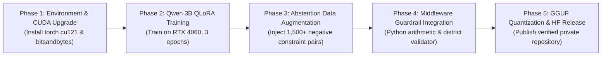

# AI-CON: Known Issues, Missing Artifacts & Phased Roadmap

**Document ID:** AI-CON-ROADMAP-10  
**Current Status:** Production Prototype Validated (Benchmark: 29.5 / 50)  
**Next Major Milestone:** GPU QLoRA Fine-Tuning & Negative Constraint SFT Expansion  

---

## 1. Known Technical Issues & Diagnostic Realities

### Issue 1: CPU-Mode PyTorch in Active Virtual Environment
- **Symptoms**: `torch.cuda.is_available()` returns `False`. Attempts to load `BitsAndBytesConfig` with 4-bit quantization throw CUDA kernel initialization exceptions.
- **Root Cause**: The active `.venv` was installed with the default CPU wheel of PyTorch (`2.14.1+cpu`).
- **Workaround / Fix**: Upgrade to `torch 2.1+cu121` via:
  ```powershell
  pip install torch torchvision --index-url https://download.pytorch.org/whl/cu121 --upgrade
  ```

### Issue 2: Autoregressive Mathematical Comparator Inversion
- **Symptoms**: In Level 3 testing, AI-CON evaluated `92.40 > 95` as true, misinforming a student that they were eligible for an unattainable college.
- **Root Cause**: Byte-pair tokenizers split decimal floats into arbitrary token fragments (e.g. `92.40` -> `['92', '.', '40']`). The autoregressive language model regurgitates plausible linguistic phrasing without evaluating arithmetic truth.
- **Remedy**: **Mandatory architectural mediation**. The LLM must never compare cutoffs. Cutoff eligibility must be calculated in Python:
  ```python
  def compare_cutoff(student_pct: float, cutoff_pct: float) -> bool:
      return student_pct >= cutoff_pct
  ```

### Issue 3: Zero-Shot Abstention Failure (Mock Card Generation)
- **Symptoms**: In Level 5 testing, when told to return `INSUFFICIENT_EVIDENCE` for colleges without verified cutoffs, both models violated the instruction and fabricated mock "College A, College B, College C" cards with ₹1.2L–₹1.4L fees.
- **Root Cause**: Standard instruction-tuned language models have a strong generative bias toward helpfulness and compliance, preferring to fabricate hypothetical examples rather than issuing a strict refusal.
- **Remedy**: Synthetic training data augmentation. Inject 1,500+ negative constraint examples into `sft_training_final.jsonl` where the only acceptable target output is:
  ```text
  STATUS: INSUFFICIENT_EVIDENCE. Official cutoff records for the requested parameters are unsupplied.
  ```

### Issue 4: Geographical Hallucination Risk in Generic Reference Models
- **Symptoms**: The 7B Reference model recommended Shri Ramdeobaba (SRCEM) in Nagpur (700+ km away) for a candidate demanding a daily commute within Pune.
- **Remedy**: In `CollegeResolver` and `RecommendationEngine`, attach district metadata coordinates and enforce a strict maximum travel radius ($< 35$ km for daily commuters).

---

## 2. Explicit Record of Missing Artifacts

In strict compliance with project auditing standards, the following artifacts do not exist yet on disk and must not be assumed to exist:

1. **`model_artifacts/qwen3b_lora_adapter/adapter_model.safetensors`**:
   - *Status*: **MISSING / NOT YET TRAINED**.
   - *Reason*: Full fine-tuning was suspended to prevent multi-day CPU thermal stress on the laptop. The directory currently contains only `README.md`.
2. **Merged Standalone 16-bit Qwen Weights**:
   - *Status*: **NOT GENERATED**.
   - *Reason*: Merging occurs only after PEFT adapter fine-tuning is completed.
3. **Public Hugging Face Repository Weights**:
   - *Status*: **HELD**.
   - *Reason*: Repositories (`yashhanamghar9099/AI-CON-MHT-CET-Counselling-LoRA` and `yashhanamghar9099/AI-CON-Qwen2.5-3B`) are prepared in script manifests but uploads are withheld until GPU adapter weights are verified.

---

## 3. Phased Engineering Roadmap



### Phase 1: CUDA Environment Upgrade (Estimated Time: 15 minutes)
- Reinstall PyTorch with CUDA 12.1 runtime on Windows.
- Verify `torch.cuda.is_available()` returns `True` with `NVIDIA GeForce RTX 4060 Laptop GPU`.
- Install `bitsandbytes` Windows binary wheels.

### Phase 2: Qwen 3B LoRA Fine-Tuning (Estimated Time: 3.5 hours on GPU)
- Execute `scripts/train_qwen_lora.py` on the 10,836 training samples in `training_data/train.jsonl`.
- Monitor training loss curves, aiming for final cross-entropy loss $< 1.50$.
- Save validated adapter weights to `model_artifacts/qwen3b_lora_adapter/adapter_model.safetensors`.

### Phase 3: Negative Constraint & Abstention SFT Injection (Estimated Time: 1 day)
- Construct 1,500 hard negative prompts (unoffered degrees, fictitious college codes, out-of-state quotas).
- Fine-tune model with high penalization on placeholder tokens (`College A`, `College B`, `XYZ`).

### Phase 4: Deterministic Guardrail Middleware (Estimated Time: 2 days)
- Bind `compare_cutoff_statistically` directly into `orchestrator.py`.
- If an LLM response contradicts the Python boolean comparator, overwrite the generated token stream with the deterministic template answer.

### Phase 5: GGUF Quantization & Private Hugging Face Deployment (Estimated Time: 1 day)
- Merge PEFT adapter into base Qwen 3B model via `merge_and_unload()`.
- Convert merged weights to GGUF using `llama.cpp` `convert_hf_to_gguf.py`.
- Quantize to `Q5_K_M`.
- Upload adapter and model card to `yashhanamghar9099/AI-CON-MHT-CET-Counselling-LoRA` on Hugging Face (private mode).
