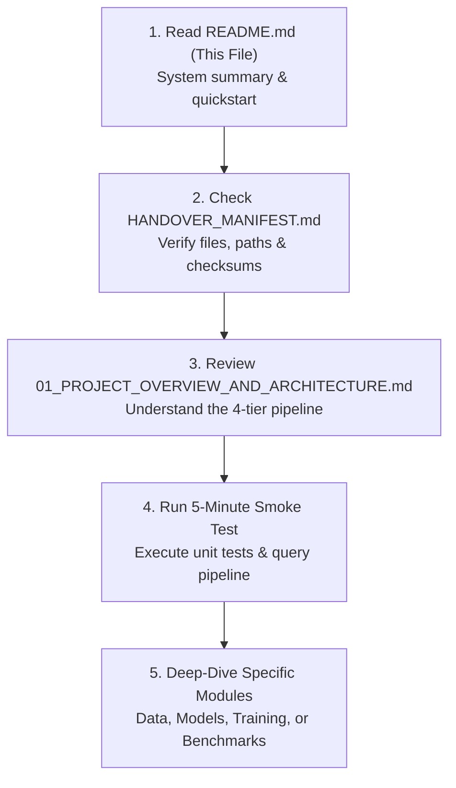

# AI-CON: MHT-CET Engineering Admissions Decision-Support System
## Complete Project Handover Package & Collaborator Onboarding Guide

**Author & Maintainer:** Yash Hanamghar (`yashhanamghar9099`)  
**Package Date:** October 2026  
**Project Status:** Active Development & Evaluation Complete  
**Handover Root:** `C:\Users\Yash Hanamghar.Nyai\Downloads\AI-cons\AI_CON_Project_Handover`  
**Core Project Workspace:** `C:\Users\Yash Hanamghar.Nyai\Downloads\AI-cons\AI-cons\AI-cons\model_rag_agent_plan`  

---

## 1. Executive Summary & Welcome

Welcome to the **AI-CON** project handover repository. This package is designed to provide you with everything required to understand, reproduce, evaluate, and extend the AI-CON admissions decision-support system without prior familiarity with the repository.

AI-CON is an AI-driven decision-support platform designed specifically for students navigating the **Maharashtra Centralized Admission Process (CAP)** for undergraduate engineering degrees (B.E. / B.Tech). The system integrates:
1. **Deterministic Historical Cutoffs** across 181,137 official admission records (`CutoffAgent`).
2. **Dense Vector Search** over 1,041 verified Maharashtra engineering institutions (`CollegeInfoAgent` using ChromaDB).
3. **Tabular Gradient-Boosted Predictors** estimating closing ranks ($R^2 = 0.58$) and percentiles ($R^2 = 0.54$) (`HistGradientBoostingRegressor`).
4. **Conversational Synthesis** delivering grounded, evidence-backed counselling answers via local quantized language models (`qwen2.5-aicon:latest` on Ollama and fine-tuned LoRA adapters).

> [!IMPORTANT]
> **Cardinal Engineering Rule of AI-CON**:  
> Language models are strictly forbidden from guessing numerical cutoffs or performing floating-point comparisons in text. All cutoffs are retrieved verbatim from deterministic data stores, inequalities are calculated in Python, and the LLM verbalizes verified evidence.

---

## 2. Where a New Collaborator Should Start

To get up to speed within 15 minutes, follow this recommended sequence:



### Immediate 5-Minute Smoke Test
Open PowerShell and run the verified test suite:

```powershell
# Navigate to active project root
Set-Location "C:\Users\Yash Hanamghar.Nyai\Downloads\AI-cons\AI-cons\AI-cons\model_rag_agent_plan"

# 1. Run Unit Tests (111 tests, ~0.5s execution)
.\.venv\Scripts\python.exe -m unittest discover tests

# 2. Test Deterministic Multi-Agent Orchestrator
.\.venv\Scripts\python.exe -c "from scripts.agents.orchestrator import Orchestrator; o = Orchestrator(); res = o.handle_query('What was the GOPENS cutoff for Civil Engineering at Government College of Engineering Amravati?'); print('Status:', res.status); print('Evidence count:', len(res.evidence))"

# 3. Test Tabular Cutoff Predictor
.\.venv\Scripts\python.exe -c "import joblib; r_model = joblib.load('model_artifacts/cutoff_regressor_rank.joblib'); print('Tabular Model Loaded:', type(r_model))"
```

---

## 3. Handover Documentation Directory

| Document | Focus Area | Key Contents |
|:---|:---|:---|
| [`HANDOVER_MANIFEST.md`](file:///C:/Users/Yash%20Hanamghar.Nyai/Downloads/AI-cons/AI_CON_Project_Handover/HANDOVER_MANIFEST.md) | File Inventory | Complete file manifest, sizes, paths, and purpose. |
| [`01_PROJECT_OVERVIEW_AND_ARCHITECTURE.md`](file:///C:/Users/Yash%20Hanamghar.Nyai/Downloads/AI-cons/AI_CON_Project_Handover/01_PROJECT_OVERVIEW_AND_ARCHITECTURE.md) | System Architecture | Problem definition, CAP complexity, 4-tier hybrid pipeline diagram. |
| [`02_SOURCE_CODE_AND_MODULE_EXPLANATIONS.md`](file:///C:/Users/Yash%20Hanamghar.Nyai/Downloads/AI-cons/AI_CON_Project_Handover/02_SOURCE_CODE_AND_MODULE_EXPLANATIONS.md) | Codebase Tour | Detailed walkthrough of every script in `scripts/`, `agents/`, and `tests/`. |
| [`03_DATASET_INVENTORY_AND_RECORD_COUNTS.md`](file:///C:/Users/Yash%20Hanamghar.Nyai/Downloads/AI-cons/AI_CON_Project_Handover/03_DATASET_INVENTORY_AND_RECORD_COUNTS.md) | Data Lineage | Verified counts for 116,744 tabular rows, 12,041 SFT pairs, 1,041 colleges. |
| [`04_DATA_MODELS_SCHEMAS_AND_RELATIONSHIPS.md`](file:///C:/Users/Yash%20Hanamghar.Nyai/Downloads/AI-cons/AI_CON_Project_Handover/04_DATA_MODELS_SCHEMAS_AND_RELATIONSHIPS.md) | Schemas & ERD | Relational and JSON data schemas, primary keys, and normalization. |
| [`05_MODEL_INVENTORY_AND_CONFIGURATIONS.md`](file:///C:/Users/Yash%20Hanamghar.Nyai/Downloads/AI-cons/AI_CON_Project_Handover/05_MODEL_INVENTORY_AND_CONFIGURATIONS.md) | ML & LLM Models | Tabular HistGradientBoosting, Ollama Qwen models, TinyLlama LoRA adapter. |
| [`06_TRAINING_PIPELINE_AND_LOGS.md`](file:///C:/Users/Yash%20Hanamghar.Nyai/Downloads/AI-cons/AI_CON_Project_Handover/06_TRAINING_PIPELINE_AND_LOGS.md) | Training Workflows | SFT formatting, tabular training run, LoRA logs, and GPU QLoRA setup. |
| [`07_INFERENCE_AND_API_INTEGRATION.md`](file:///C:/Users/Yash%20Hanamghar.Nyai/Downloads/AI-cons/AI_CON_Project_Handover/07_INFERENCE_AND_API_INTEGRATION.md) | Serving & APIs | Orchestrator Python API, Ollama REST endpoints, and CLI queries. |
| [`08_BENCHMARK_EVALUATION_AND_ANALYSIS.md`](file:///C:/Users/Yash%20Hanamghar.Nyai/Downloads/AI-cons/AI_CON_Project_Handover/08_BENCHMARK_EVALUATION_AND_ANALYSIS.md) | Benchmark Results | 5-Level progressive evaluation, `92.40 < 95.00` error audit, scorecard. |
| [`09_ENVIRONMENT_SETUP_AND_EXECUTION_GUIDE.md`](file:///C:/Users/Yash%20Hanamghar.Nyai/Downloads/AI-cons/AI_CON_Project_Handover/09_ENVIRONMENT_SETUP_AND_EXECUTION_GUIDE.md) | Reproduction | Fresh virtualenv setup, dependency locks, Ollama setup, and GPU fixes. |
| [`10_KNOWN_ISSUES_AND_FUTURE_ROADMAP.md`](file:///C:/Users/Yash%20Hanamghar.Nyai/Downloads/AI-cons/AI_CON_Project_Handover/10_KNOWN_ISSUES_AND_FUTURE_ROADMAP.md) | Backlog & Blockers | CPU PyTorch blocker, bitsandbytes on Windows, Hugging Face roadmap. |
| [`GOOGLE_DRIVE_UPLOAD_AND_COMPLIANCE_GUIDE.md`](file:///C:/Users/Yash%20Hanamghar.Nyai/Downloads/AI-cons/AI_CON_Project_Handover/GOOGLE_DRIVE_UPLOAD_AND_COMPLIANCE_GUIDE.md) | Cloud Packaging | Large file exclusions (`.venv`, Chroma sqlite, GGUFs), policy rules, and upload manifest. |

---

## 4. Key Performance Indicators & Verified Metrics

| Dimension | Metric / Target | Verified Empirical Result | Status |
|:---|:---|:---:|:---:|
| **Unit Test Coverage** | 111 unit tests in test suite | **109 Passed, 2 Skipped, 0 Failed** | Verified |
| **Tabular Rank Model** | $R^2 > 0.50$, MAE on 15,000 test set | **$R^2 = 0.5808$, MAE = 28,259.2** | Verified |
| **Tabular Percentile Model** | $R^2 > 0.50$, MAE on 15,000 test set | **$R^2 = 0.5366$, MAE = 14.88%** | Verified |
| **Cutoff Database Scale** | Historical records (2020–2025) | **181,137 verified allotment records** | Verified |
| **College Profiles Indexed** | Maharashtra engineering colleges | **1,041 institution profiles in ChromaDB** | Verified |
| **Benchmark (AI-CON 3B)** | 5-Level progressive evaluation | **29.5 / 50 (59.0%)** (Avg Latency: 20.44s) | Verified |
| **Benchmark (Reference 7B)** | 5-Level progressive evaluation | **33.0 / 50 (66.0%)** (Avg Latency: 37.92s) | Verified |
| **LoRA Adapter (TinyLlama)** | 10 steps smoke training | **`adapter_model.safetensors` (4.51 MB)** | Verified |
| **QLoRA Adapter (Qwen 3B)** | 4-bit fine-tuning | **Pending CUDA PyTorch upgrade** | Documented |

---

## 5. Security, Secrets, and Safe Collaboration

> [!WARNING]
> - **Zero Hardcoded Secrets**: This project does not require or contain API keys, passwords, or cloud credentials. Local inference runs completely self-contained via Ollama.
> - **External Upload Prohibition**: Do not upload proprietary admissions records or student identifying information to public model hubs or unapproved third-party APIs.
> - **Private Hugging Face Deployment**: When publishing LoRA adapters (`yashhanamghar9099/AI-CON-MHT-CET-Counselling-LoRA`), ensure repositories are set to **Private** initially.
