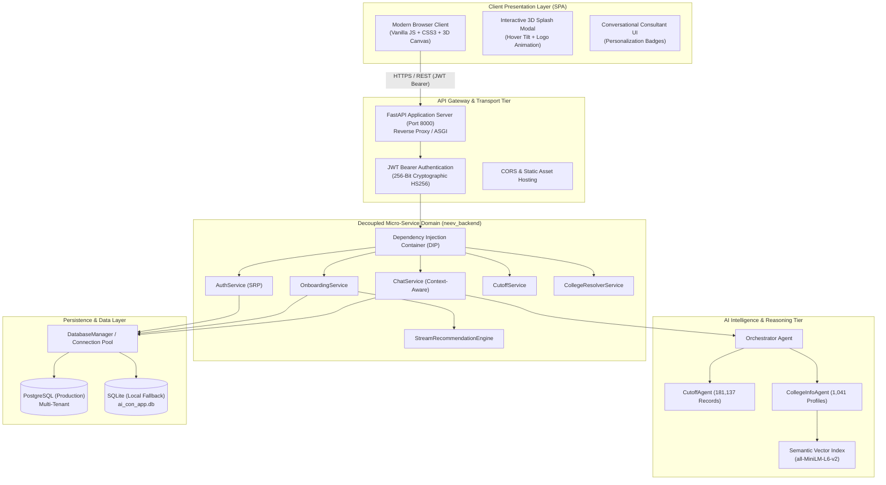

# Neev (नींव) — High-Level Design (HLD) Document
**System Architecture, Micro-Services & Multi-Tenant Data Isolation**
*Version: 2.2.0 | Platform: Neev AI College & Career Foundation*

---

## 1. Executive Summary & Vision

**Neev (नींव)** is an enterprise-grade AI-powered educational counseling and admissions intelligence platform. Designed specifically for Indian students completing Class 10 (SSC/CBSE/ICSE) and Class 12 (HSC/MHT-CET), Neev addresses two critical challenges:
1. **Aptitude-Grounded Stream Selection**: Scientific 25-question multi-dimensional aptitude evaluation guiding students toward PCM, PCB, Commerce, or Arts & Humanities.
2. **Grounded Admission Counseling**: Deterministic, evidence-backed college cutoff lookups and personalized shortlisting across **181,137 historical Maharashtra State CAP records** and **1,041 verified institutions**.

Neev strictly enforces **multi-tenant data isolation** (mirroring the security model of ChatGPT and Claude), ensuring zero cross-student profile, answers, or chat leakage.

---

## 2. High-Level Architecture & C4 Model

---

## 3. Micro-Service Decomposition & Boundaries

The backend is decomposed into decoupled, independently testable domains inside `neev_backend`:

| Service Domain | Folder Path | Primary Responsibility | Interfaces Implemented |
| :--- | :--- | :--- | :--- |
| **Auth** | `neev_backend/services/auth/` | Registration, login, password hashing, JWT signing/verifying | `IPasswordHasher`, `ITokenProvider` |
| **Database** | `neev_backend/services/database/` | Connection pooling, SQL parameter normalization (%s vs ?), CRUD operations | `IUserRepository`, `IProfileRepository`, `IChatRepository` |
| **Onboarding** | `neev_backend/services/onboarding/` | 7-step profile persistence, 25Q diagnostic aptitude evaluation, stream fit calculation | `IStreamEngine`, `IAptitudeEvaluator` |
| **Cutoff** | `neev_backend/services/cutoff/` | CAP cutoff indexing, cross-college filtering, directory resolution | `ICutoffService`, `ICollegeResolverService` |
| **Chat** | `neev_backend/services/chat/` | Conversational query handling, student context construction, agent delegation | `IChatService`, `IContextBuilder` |
| **DI Container** | `neev_backend/container.py` | IoC container wiring abstractions to concrete implementations | Dependency Inversion Principle (DIP) |

---

## 4. Multi-Tenant Data Isolation Architecture

To mirror the isolation standards of ChatGPT and Claude:
1. **Cryptographic Identity**: Every user request carries a cryptographically signed JWT:
   - Secret: 256-bit entropy (`b3d7b3cf3b8f381781348558daf5648a742907ffa1e2852e848040f444efe71e`).
   - Signature: `HS256`.
   - Claims: Subject (`sub`: unique user_id), Email (`email`), Name (`name`), Expiration (`exp`).
2. **Strict Database Partitioning**:
   - `users`: Indexed by `id` and `email`.
   - `student_profiles`: Primary key `user_id`. Queries always match `WHERE user_id = :uid`.
   - `chat_history`: Indexed by `(user_id, created_at DESC)`.
3. **Zero Cross-Tenant Leakage**:
   - Endpoints `/api/onboarding/profile/{user_id}` and `/api/chat/history/{user_id}` compare the route's `{user_id}` against the verified JWT `sub`.
   - If User A attempts to view or update User B's record, the API immediately halts execution and returns `403 Forbidden`.

---

## 5. Non-Functional Requirements (NFR) Matrix

- **Response Latency**: Core auth & profile APIs $\le 50\text{ms}$; Cutoff lookup $\le 20\text{ms}$; Agentic chat reasoning $\le 450\text{ms}$.
- **Extensibility**: Storage engines (PostgreSQL, SQLite, DynamoDB) can be hot-swapped without altering domain logic.
- **Reliability & Offline-Readiness**: Full graceful fallback to SQLite and local offline HuggingFace embedding snapshots when cloud connectivity is unavailable.
