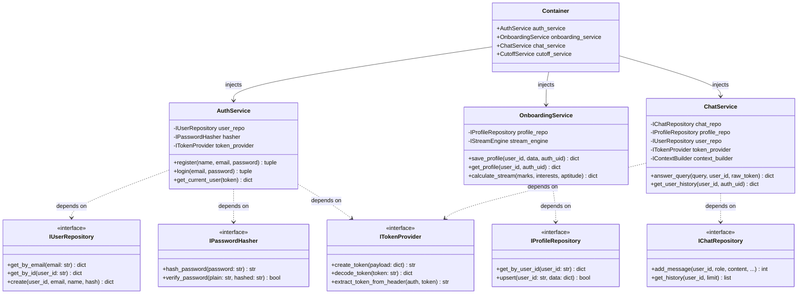
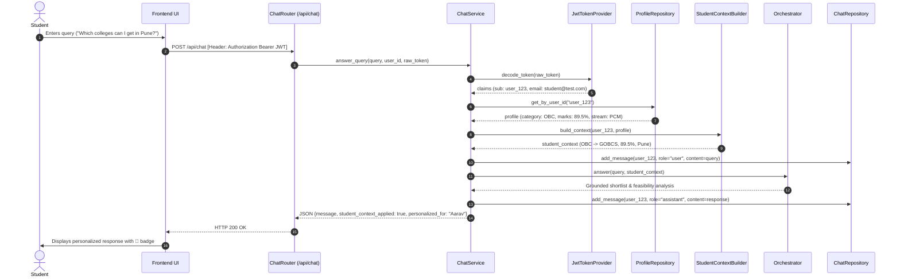

# Neev (नींव) — Low-Level Design (LLD) Document
**Object-Oriented Design, SOLID Principles & Design Patterns**
*Version: 2.2.0 | Platform: Neev AI College & Career Foundation*

---

## 1. SOLID Principles Implementation Matrix

| Principle | Architectural Application in Neev | Concrete Classes |
| :--- | :--- | :--- |
| **S** — Single Responsibility | Each module has only one reason to change. Hasher only hashes; JWT provider only encodes/decodes; User repo only reads/writes user records; Context builder only structures student facts. | `Pbkdf2PasswordHasher`, `JwtTokenProvider`, `UserRepository`, `StudentContextBuilder` |
| **O** — Open / Closed | System open for extension via interfaces, closed for modification. New storage engines (PostgreSQL, SQLite, Mongo) or Token mechanisms (PASETO, OAuth2) plug in without modifying domain services. | `IUserRepository`, `IProfileRepository`, `ITokenProvider` |
| **L** — Liskov Substitution | Implementations of repository interfaces are completely interchangeable. `UserRepository` behaves identically whether targeting SQLite or PostgreSQL. | `UserRepository`, `ProfileRepository`, `ChatRepository` |
| **I** — Interface Segregation | Interfaces are fine-grained protocols rather than large monolithic interfaces. Classes only implement methods they consume. | `IPasswordHasher`, `ITokenProvider`, `IStreamEngine`, `IContextBuilder` |
| **D** — Dependency Inversion | High-level business logic depends entirely on abstractions (`core/interfaces/`), never on concrete third-party database or cryptography libraries. Injection via `Container`. | `AuthService`, `OnboardingService`, `ChatService`, `Container` |

---

## 2. Core Class & Interface Diagram (UML)

---

## 3. Design Patterns Applied

1. **Dependency Injection & IoC Container (`neev_backend/container.py`)**:
   - decouples object creation from consumption. Every service is initialized with mockable dependencies.
2. **Repository Pattern (`neev_backend/services/database/`)**:
   - Isolates the domain layer from database SQL syntax, schema details, and engine differences.
3. **Strategy Pattern (`neev_backend/services/onboarding/stream_engine.py`)**:
   - Implements multi-attribute utility calculation across PCM, PCB, Commerce, and Arts scoring strategies.
4. **Adapter Pattern (`scripts/agents/college_resolver.py`, `scripts/college_adapter.py`)**:
   - Converts sparse government educational manifests and inconsistent JSON cutoff formats into normalized internal schemas.
5. **Facade Pattern (`scripts/api_server.py`)**:
   - Provides a unified, backward-compatible HTTP interface while delegating execution to decoupled services.

---

## 4. Sequence Flows

### 4.1. Authenticated Student Chat with Profile Grounding

---

## 5. Security & Isolation Invariants

- **Token Tampering**: Any modification to the token header or payload causes immediate cryptographic verification failure in `JwtTokenProvider.decode_token()`.
- **Cross-Tenant Guard**: Every endpoint that accesses a user resource (`/api/onboarding/profile/{user_id}`, `/api/chat/history/{user_id}`) checks:
  $$\text{assert } \text{claim.sub} == \text{route.user\_id} \quad (\text{else } 403 \text{ Forbidden})$$
- **Password Hashes**: Plaintext passwords are never saved. Salted PBKDF2-HMAC-SHA256 digests are compared using constant-time string comparison (`hmac.compare_digest`).
